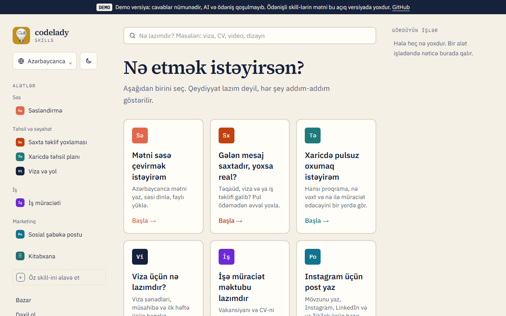
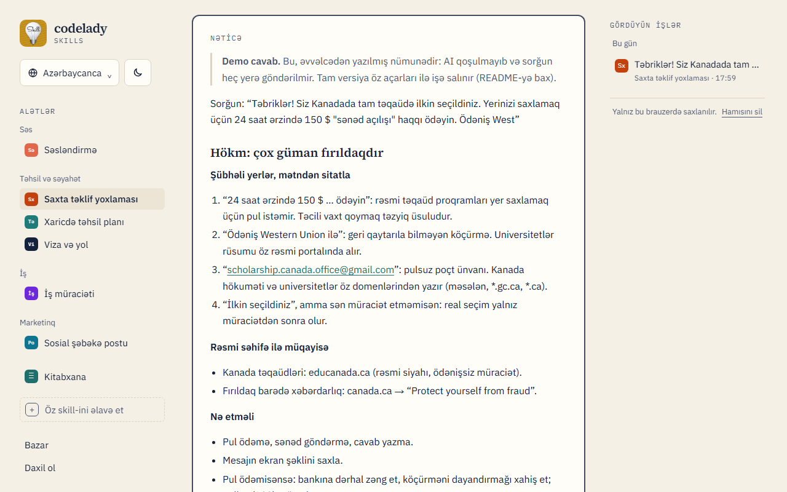
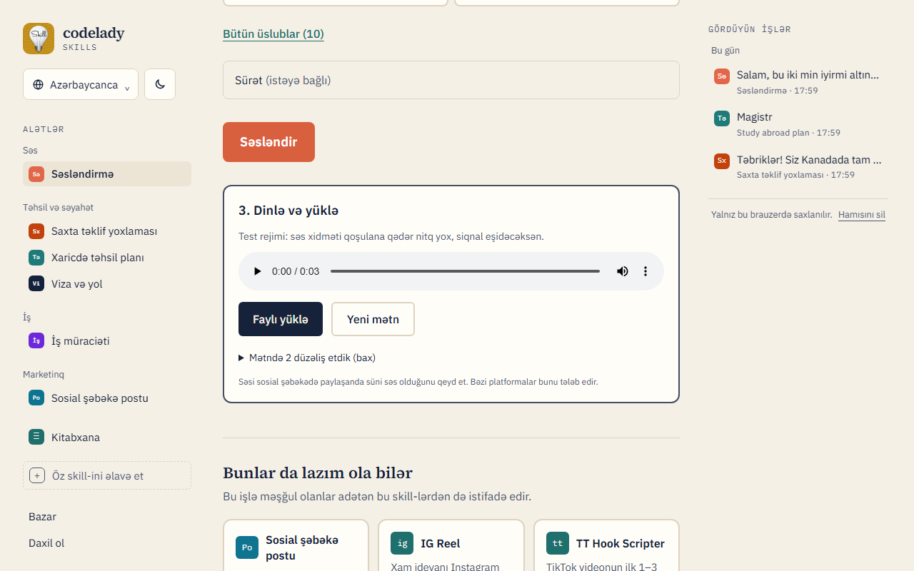
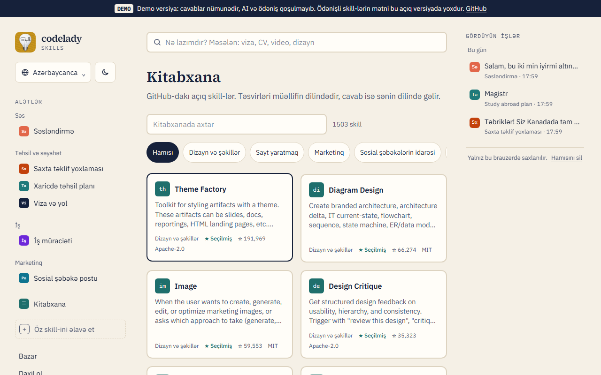
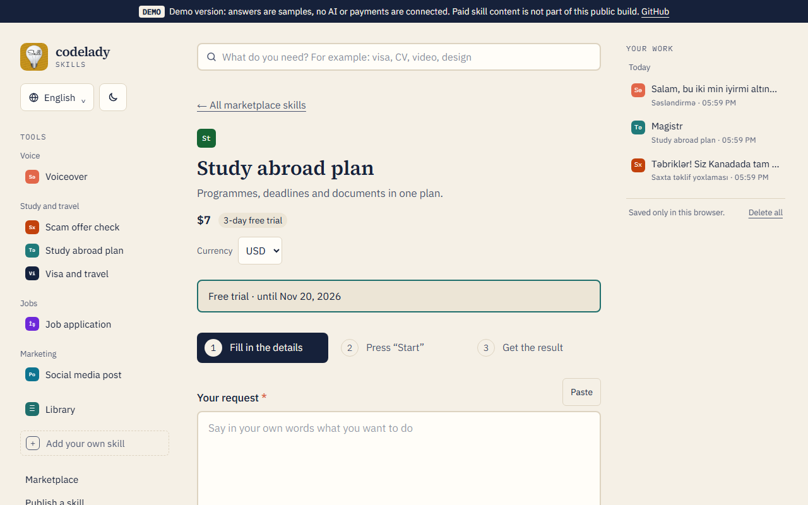
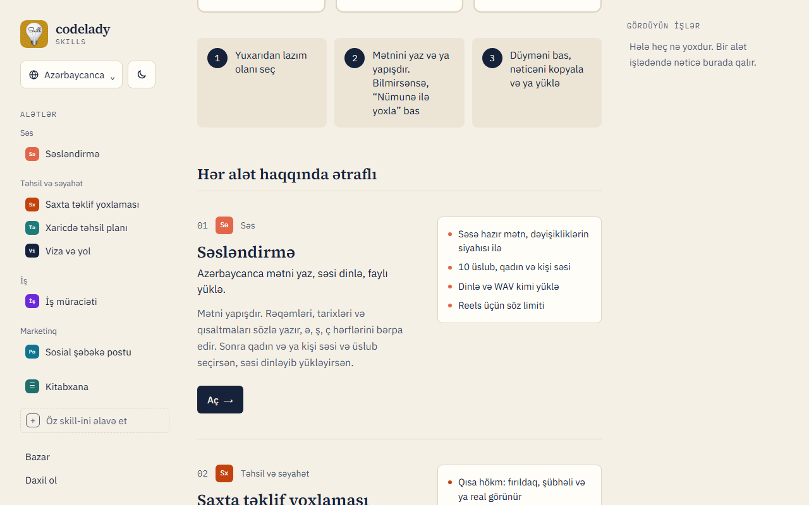
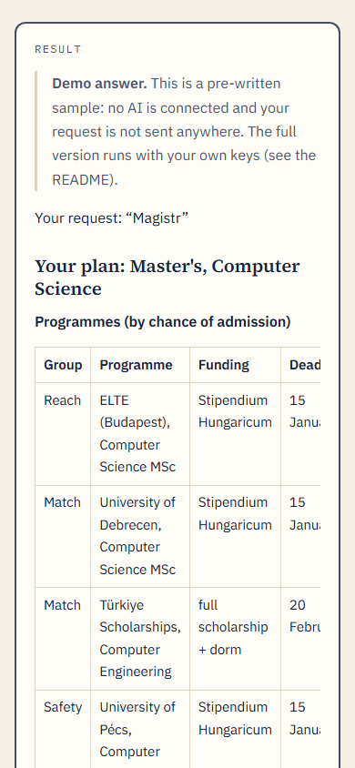
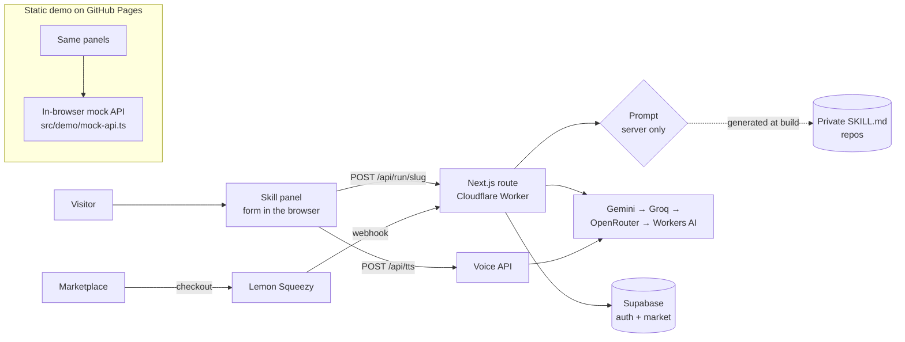

# Codelady Skills

**Live demo:** https://codelady-ship.github.io/codelady-skills/

[Azərbaycanca](#azərbaycanca) · [English](#english)



---

## Azərbaycanca

### Bu nədir?
Codelady Skills Claude skill-lərini hər kəsin işlədə biləcəyi bir veb sayta çevirir. Hər skill-in öz iş paneli var: formanı doldurursan, düyməni basırsan, nəticəni alırsan. Söhbət yazmaq və ya prompt bilmək lazım deyil. Sayt 14 dildə işləyir: az, en, ru, tr, de, fr, es, it, pt, pl, uk, kk, uz, ka.

Skill-lər xaricdə təhsil, viza, iş axtarışı, səsləndirmə və sosial şəbəkə üçündür. Yanında GitHub-dakı 1500-dən çox açıq skill-dən ibarət Kitabxana və müəlliflərin öz skill-lərini satdığı Bazar var.

### Demo versiya
GitHub Pages-dəki demo statik saytdır: server, açar və hesab lazım deyil.
- Cavablar əvvəlcədən yazılmış nümunələrdir. Hər birinin üstündə **Demo cavab** yazılıb.
- Səsləndirmə nitq əvəzinə qısa siqnal yaradır. Mətni səsə hazırlayan hissə isə (rəqəmlər sözlə, ə/ş/ç hərflərinin bərpası) tam işləyir.
- Bazarda test hesabı ilə daxil olmaq, pulsuz sınaq başlatmaq və test alışı etmək olar. Hamısı yalnız bu brauzer tabında saxlanır.
- Ödənişli skill-lərin təlimatları (SKILL.md) bu repoda **yoxdur**. Aşağıda "Nə daxil deyil" bölməsinə bax.

### Skill panelləri
| Panel | Nə edir | Qiymət |
|---|---|---|
| Səsləndirmə | Azərbaycanca mətni səsə hazırlayır: rəqəm, tarix və qısaltmaları sözlə yazır, hərfləri bərpa edir. 10 üslub, qadın və kişi səsi, WAV yükləmə | Pulsuz |
| Saxta təklif yoxlaması | Təqaüd, viza və ya iş təklifindəki şübhəli yerləri mətndən sitatla göstərir, rəsmi mənbə ilə müqayisə edir | Pulsuz |
| Xaricdə təhsil planı | Profilə görə proqramları çətin / uyğun / ehtiyat qruplarına bölür, son tarixlər və sənəd siyahısı | Birdəfəlik $7 |
| Viza və yol | Viza sənəd siyahısı, müsahibə məşqi, gəlişdən sonra ilk həftə | Birdəfəlik $5 |
| İş müraciəti | Vakansiya ilə CV-nin uyğunluğu, çatışmayanlar, müraciət məktubu, fırıldaq yoxlaması | Birdəfəlik $5 |
| Sosial şəbəkə postu | Bir mövzudan bir neçə post variantı, hashtag və vaxt təklifi (MIT, coreyhaines31/marketingskills) | Pulsuz |

Əlavə: **Kitabxana** (GitHub-dakı açıq skill-lər, kateqoriya və axtarış), **Öz skill-ini əlavə et** (açıq GitHub linkindən), **Gördüyün işlər** (tarixçə, yalnız brauzerdə), **Bazar** (pulsuz, birdəfəlik və aylıq skill-lər, 3/7/14 günlük sınaq), gecə rejimi, telefona quraşdırma (PWA).

### Lokal işə salmaq
```bash
npm install
npm run dev            # http://localhost:3000, açarsız test rejimi
npm run build:demo     # statik demo → out/ (GitHub Pages üçün)
npm test               # testlər (Node 23.6+)
```
Real cavablar üçün `.env.example` faylını `.env.local` adı ilə kopyala və öz açarlarını yaz. `.env.local` git-ə düşmür.

### Nə daxil deyil və niyə
- **Ödənişli skill-lərin mətni.** Tam versiyada `scripts/sync-skills.mjs` hər skill-in SKILL.md faylını şəxsi repolardan `src/server/prompts.generated.ts` faylına köçürür. Bu fayl `.gitignore`-dadır və heç vaxt commit olunmur. Demo build onu ümumiyyətlə oxumur.
- **Açarlar və hesablar.** Repoda yalnız boş `.env.example` var.
- **Skill repolarına linklər.** Müəllifin skill repoları şəxsidir, ona görə demo onlara link vermir. Ödənişli skill-lər Agensi-də satılır.

---

## English

### What it is
Codelady Skills turns Claude skills into a website anyone can use. Every skill has its own working panel: fill in a form, press a button, get the result. No chatting and no prompt writing. The site runs in 14 languages.

The skills cover studying abroad, visas, job applications, Azerbaijani voiceover and social media. There is also a Library of 1,500+ open skills from GitHub and a Marketplace where creators sell their own skills.

### Demo mode
The GitHub Pages demo is a static site with no server, no keys and no accounts.
- Answers are pre-written samples, each marked **Demo answer**.
- Voiceover makes a short tone instead of speech. The text preparation step (numbers to words, restoring ə/ş/ç) runs for real.
- In the Marketplace you can sign in with a test account, start a free trial and make a test purchase. Everything stays in this browser tab.
- Paid skill instructions (SKILL.md) are **not** in this repository. See "What is left out" below.

### Skill panels
| Panel | What it does | Price |
|---|---|---|
| Voiceover | Prepares Azerbaijani text for speech: numbers, dates and abbreviations as words, missing letters restored. 10 styles, female and male voices, WAV download | Free |
| Scam offer check | Quotes the suspicious parts of a scholarship, visa or job offer and compares them with the official source | Free |
| Study abroad plan | Sorts programmes into reach / match / safety, with deadlines and a document list | $7 one-time |
| Visa and travel | Visa checklist, interview practice, the first week after arrival | $5 one-time |
| Job application | CV-to-vacancy match, gaps, cover letter, scam check | $5 one-time |
| Social media post | Several post versions from one topic, hashtags and timing (MIT, coreyhaines31/marketingskills) | Free |

Also: **Library** (open GitHub skills with categories and search), **Add your own skill** (from a public GitHub link), **Your work** (history kept in the browser), **Marketplace** (free, one-time and monthly skills with 3/7/14-day trials), dark mode, install as an app (PWA).

### Screenshots
| | |
|---|---|
|  |  |
|  |  |
|  |  |

### Tech stack
- Next.js 16 (App Router, Turbopack), React 19, TypeScript
- Tailwind CSS 4
- Supabase (sign-in, database with Row Level Security)
- Cloudflare Workers via @opennextjs/cloudflare (production), GitHub Pages (static demo)
- Gemini for answers and speech, with Groq, OpenRouter and Workers AI as fallbacks
- Lemon Squeezy for payments (test mode)

### Architecture

In the static demo the API routes are left out of the build and `src/demo/mock-api.ts` answers the same `/api/*` calls in the browser with sample data.

### Run locally
```bash
npm install
npm run dev            # http://localhost:3000, test mode without keys
npm run build:demo     # static demo into out/ (base path /codelady-skills)
npm test               # unit tests (Node 23.6+)
npm run deploy         # Cloudflare Workers (needs your own account and secrets)
```
Copy `.env.example` to `.env.local` and add your own keys for real answers. `.env.local` is git-ignored. Marketplace setup: [docs/MARKETPLACE.md](docs/MARKETPLACE.md).

### Environment variables
Names only. Put values in `.env.local` locally, and in `npx wrangler secret put NAME` on Cloudflare.

| Name | Purpose |
|---|---|
| `SITE_URL` | Public address, used for sign-in and checkout return links |
| `ADMIN_EMAILS` | Emails that get the admin page |
| `MOCK_AUTH`, `MOCK_SESSION_SECRET` | Local test accounts (never on in production) |
| `SUPABASE_URL`, `SUPABASE_ANON_KEY`, `SUPABASE_SERVICE_ROLE_KEY` | Sign-in and database (service role is server only) |
| `MARKET_PAYMENT_PROVIDER`, `MARKET_FEE_PERCENT` | Payment provider and platform share |
| `LEMONSQUEEZY_API_KEY`, `LEMONSQUEEZY_STORE_ID`, `LEMONSQUEEZY_VARIANT_ONE_TIME`, `LEMONSQUEEZY_VARIANT_MONTHLY`, `LEMONSQUEEZY_WEBHOOK_SECRET`, `LEMONSQUEEZY_TEST_MODE` | Lemon Squeezy checkout and webhooks |
| `GEMINI_API_KEY`, `GEMINI_TEXT_MODELS`, `GEMINI_TTS_MODELS` | Answers and speech |
| `AI_PROVIDERS`, `GROQ_API_KEY`, `GROQ_MODELS`, `OPENROUTER_API_KEY`, `OPENROUTER_MODELS` | Fallback AI services, in order |
| `TTS_PROVIDER`, `ELEVENLABS_API_KEY` | Speech engine (mock when unset) |
| `RUN_LIMIT_PER_HOUR` | Requests per visitor per hour |
| `NEXT_PUBLIC_DEMO`, `NEXT_PUBLIC_BASE_PATH` | Set by `npm run build:demo` only |

### What is left out, and why
- **Paid skill instructions.** In the full version `scripts/sync-skills.mjs` copies each skill's SKILL.md from the private skill repos into `src/server/prompts.generated.ts`. That file is git-ignored, is only imported by server routes, and never reaches the browser. The demo build does not read it at all.
- **Keys and accounts.** Only an empty `.env.example` is committed.
- **Links to the skill repos.** The author's skill repos are private, so the demo doesn't link them. Paid skills are sold on [Agensi](https://www.agensi.io).

### Roadmap
- [ ] Production deploy on Cloudflare Workers with Supabase and Gemini keys
- [ ] Real Lemon Squeezy checkout (out of test mode)
- [ ] Bundle listing: Study abroad + Visa and travel + Job application
- [ ] More languages for the built-in sample answers
- [ ] Own-voice cloning with consent checks (Pro plan)

### License and credits
MIT, see [LICENSE](LICENSE). Built by Antiqa ([@codelady-ship](https://github.com/codelady-ship)).
- Social media post panel: [coreyhaines31/marketingskills](https://github.com/coreyhaines31/marketingskills) (MIT)
- Library entries come from public GitHub repos; each keeps its own license (shown on its card)
- Fonts: IBM Plex Sans, IBM Plex Mono, Source Serif 4 (Google Fonts, OFL)
